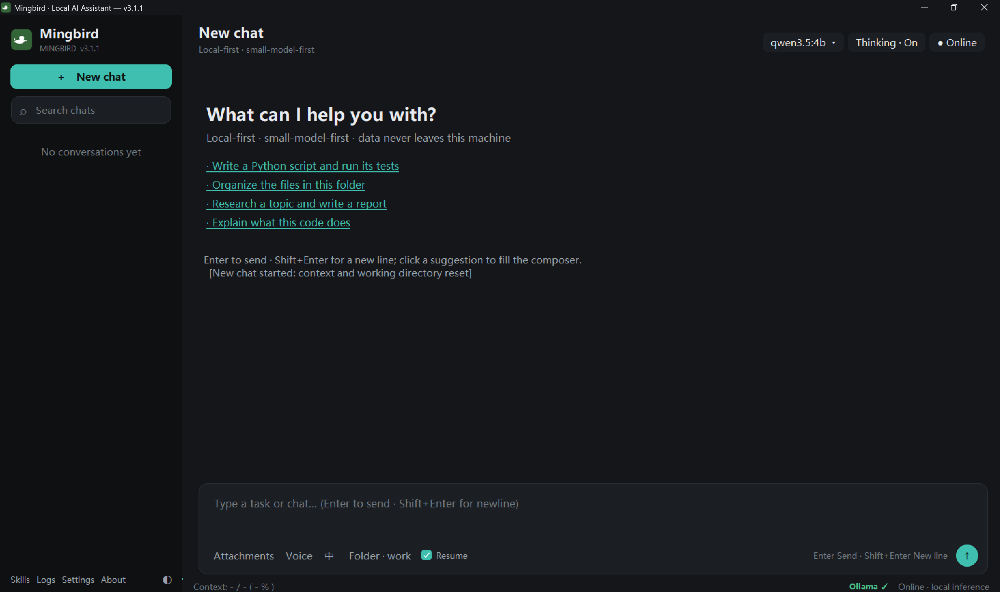
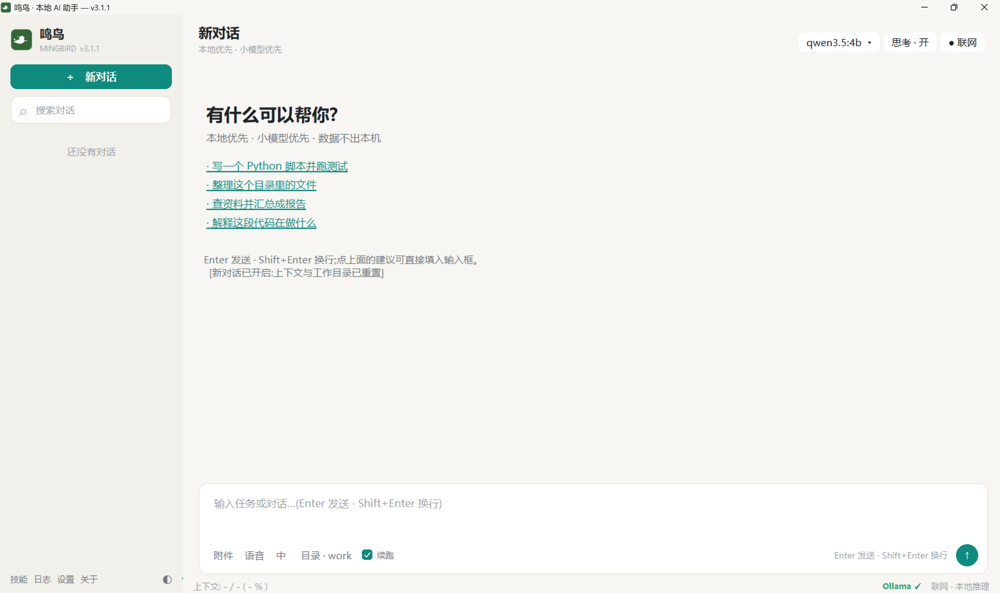
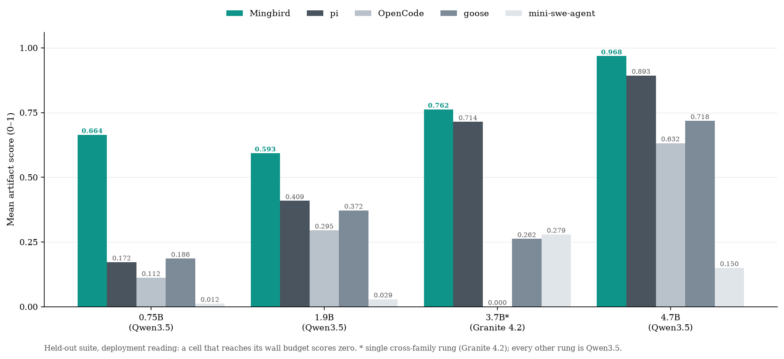
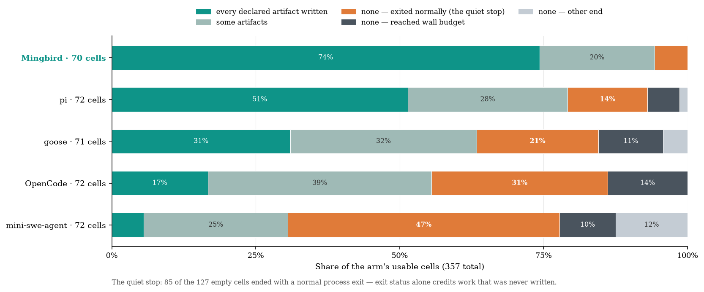
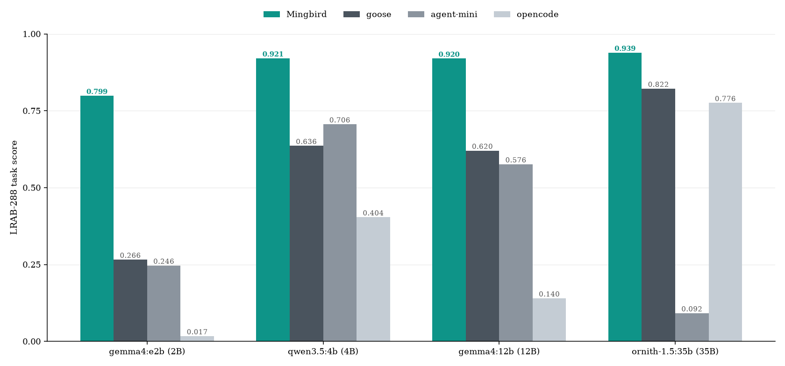
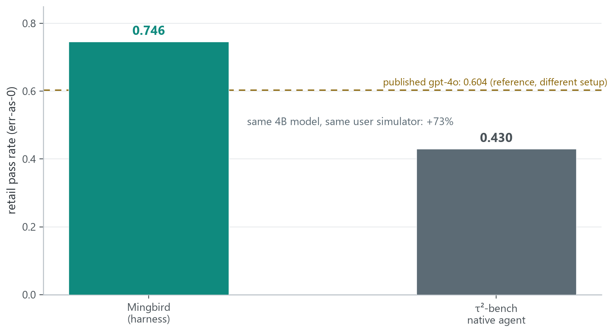
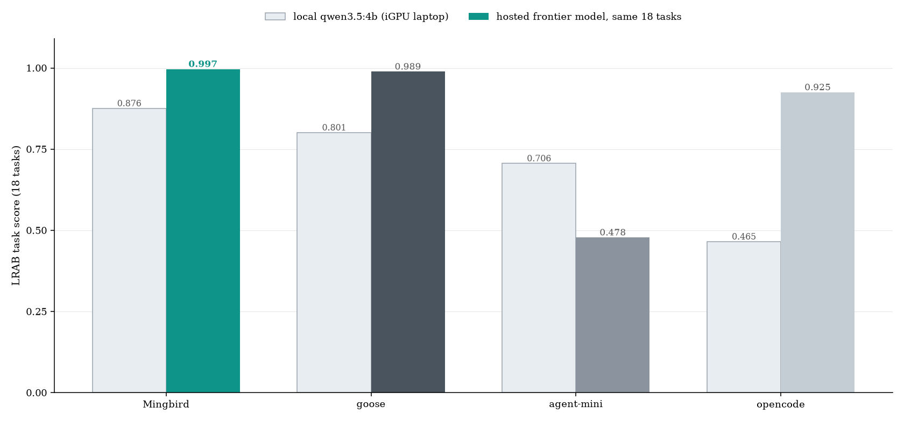

# 🐦 Mingbird

**A local-first agent harness that finishes real tasks on the machine you already own — 2–9B models on integrated graphics.**

[中文版](README_zh.md) · Apache-2.0 · Windows 10/11 · Linux & macOS (experimental) · Offline-first

> **Same 2B model: 0.017 → 0.821. The harness was the problem.**
>
> You've been told local models need a big discrete GPU. On an ordinary laptop — integrated graphics, 16–32 GB of RAM — the same 2–9B models that stall in cloud-style frameworks deliver finished files here, because the failures you have seen are harness defects, not model defects. Measured end to end; all 288 result cells public. And nothing about your work ever leaves the machine.
>
> **It holds at every size, too.** A second study ran five real agent tools — Mingbird and four competitors, all as shipped — on the same eighteen fresh tasks across four open models from 0.75B to 4.7B: 360 runs, judged only by what actually lands on disk. Mingbird finished first at every model size, from 0.664 vs the best rival's 0.186 at 0.75B to 0.968 vs 0.893 at 4.7B. [Second paper →](https://doi.org/10.48550/arXiv.2611.21407)

Current release **v3.1.12** · 📄 Papers: [design — what small models can't do for themselves](https://doi.org/10.48550/arXiv.2610.02001) · [measurement — five harnesses, 0.75B–4.7B](https://doi.org/10.48550/arXiv.2611.21407) · actively maintained ([CHANGELOG](CHANGELOG.md)) · one-click offline mode · CI builds Linux/macOS artifacts · 730 tests

**English UI (dark theme)**



**中文界面 / Chinese UI (light theme)**



## What makes it different

Every mechanism comes from "small models can't do X, so the harness does it for them":

| Small models can't… | Mingbird does it for them |
|---|---|
| …self-debug | the harness runs the tests itself and feeds back exact failures (`file:line` + the original error text) |
| …edit code safely | every change is auto-backed up (`.bak`, including in-place shell edits like `sed -i`); rollback is one command |
| …escape tool-demo loops | Q&A/task layering (chat answers once and stops) + a signature-level anti-loop ladder: nudge → hard reset → graceful exit |
| …stop repeating one broken command until the context fills | the harness detects the repeat, blocks the call, resets the context — the exact failure mode that empties competitors' working directories (measured below) |
| …fit all tools in context | tools load by category, and the built-in prompt overhead stays frozen at 1319 estimated tokens — any change, up or down, fails CI; per-turn facts (platform, reply language) ride outside the frozen part |
| …match the language you write in | replies follow each message's language — three-tier offline detection; when unsure, it injects nothing rather than guessing |
| …emit a large file in one call | per-call output cap is 8192 (was 2048); when truncation still bites, the model gets "write the skeleton, then append" chunked feedback instead of an empty-turn spiral |
| …stop crawling through huge files | crawl guard v2 works on a byte budget (2× file size, clamped to 64KB–512KB) — it never refuses |
| …stay on target in long tasks | delivery self-check gate: before claiming done, it re-reads the original task and verifies its work |
| …resist destructive impulses | a five-ring safety net catches them (see [Safety](#safety)) |

Nothing is hardcoded: the engine, endpoint, GPU environment variables, and model aliases are detected at runtime or configured in `~/.ollama_agent/config.json` (see [AGENTS.md](AGENTS.md)); since v2.1.1 the engine can be Ollama or any OpenAI-compatible local server (LM Studio, llama.app, llama-server, Jan, vLLM); since v3.0.0 the harness is platform-aware — per-task injection of the real OS/shell/command facts from a single `platform_profile` source; since v3.1.11 replies follow the user's language; since v3.1.12 local-inference traffic always connects directly and cannot be intercepted by a system proxy. The quality floor is held up by a 730-test regression suite — 435 unit + 26 integration + 269 added since v1.9.1, the prefill no-change assertion (any edit — growth or shrinkage — fails CI) among them. The suite contains **no live-Ollama end-to-end test**: nothing in it needs a running backend or a network. The benchmark runners under `bench/` and `benchmarks/` are separate programs and are not part of the pytest suite.

## The problem we set out to solve

Mainstream agent frameworks are designed for large cloud models. Feed them a 2B local model and everything from the demo videos falls apart: full-tool prefill blows the context, the model cannot self-correct, it loops on tool calls, or quietly gives up halfway through. **Our claim: these are harness defects, not model defects** — small models usually know what to do; what they cannot do is reliably output and execute it, step by step.

This is not a lonely observation. Recent public work points the same way — guardrail-first harnesses on the front page ("guardrails take an 8B model from 53% to 99%"), the "why your local LLM feels dumber than it is" discussions, local-inference talk shifting from *can it run* to *can it ship*. What was missing was someone finishing the 2–9B tier end to end. That is this project.

## What it can do

- **Real tasks**: write code and run the tests, organize files, web research, analyze data, call MCP tools.
- **One-click offline mode (v1.8.0)** — 🔒 in the toolbar: local model only, web tools not even assembled into the prompt, zero outbound by construction (see [Where your data lives](#where-your-data-lives)).
- **Replies follow your language (v3.1.11)** — write English on a Chinese-locale machine and it answers in English; switch mid-session and it follows. Detection is three-tier and fully offline (Unicode script ranges → greeting table → bundled 938 KB fastText model, 176 languages). Your message is sent byte-for-byte unchanged; when detection is not confident, nothing is injected.
- **Streaming output + visible thinking** — the delivery streams; the thinking folds away once the run is done.
- **Drag-and-drop / paste attachments** — drop a file into the chat or press Ctrl+V: clipboard files and screenshots become attachments on the spot, sent along with your instruction.
- **Voice input out of the box, Chinese & English** — the installer bundles two local STT models (pure CPU, ~20× real time); a 中/EN toggle by the mic; it stops automatically when you stop talking.
- **Task time-box (off by default)** — type `40` / `1.5h` / `half an hour` into the box, or write "限时 40 分钟" (or "timebox 40 minutes") right in the task description (auto-detected, highest priority); the harness nudges the run to wind down as the deadline approaches. Local-model users care about wall-clock time.
- **Session memory** — history persists locally; searchable and replayable.
- **Multiple local engines** — Ollama is the default (auto-started, keep-alive, thinking tri-state), and any OpenAI-compatible local server works too: pick **LM Studio** (`:1234/v1`), **llama.app** — the official llama.cpp desktop app (`:9931/v1`), **llama-server** (`:8080/v1`) or a custom endpoint in Settings. Streaming, thinking-channel separation (inline `<think>` tags are stripped live, even torn across stream chunks) and tool calls work across engines.
- **Model auto-detection** — whatever your engine has loaded is what you use, up to 1M context.
- **Skills & MCP** — 17 built-in skills (11 coding + 6 universal: files, web research, doc digest, Word/Excel, images) load on demand; drop your own .md into `~/.ollama_agent/skills/`; MCP servers are plain JSON config. The bundled Python runtime (`run_python`) backs the office/image skills — no Python or Office install needed.
- Bilingual UI (English / 中文).
- **Web UI (experimental)** — the same agent in your browser, local-only, 127.0.0.1 only ([guide](docs/webui.md)).
- **One-click installer**, or run from source.

## Measured

### Five harnesses, four sizes: the ladder

Five real agent tools, all shipped unmodified — Mingbird v3.1.9, pi 1.3.0, OpenCode 1.18.23, goose 1.48.0, mini-swe-agent 2.4.6 — were given the same eighteen fresh tasks (frozen before the first run, never tuned on) across four open models from 0.75B to 4.7B, plus a 35.5B anchor at the top. Same machine, same Ollama 0.40.6 server, temperature 0, thinking off, 32K context for every arm. A deterministic checker reads only the working directory — never the transcript. **360 runs.**



- **First place at every size**: 0.664 / 0.593 / 0.762 / 0.968, against the best rival's 0.186 / 0.409 / 0.714 / 0.893. Thirteen of the sixteen pairwise gaps are statistically distinguishable from zero (a run that outlives its time budget scores zero); two of the four pre-registered comparisons — against goose, Holm-corrected — survive, at 0.75B (p=0.0067) and 4.7B (p=0.0410).
- **The strongest rival is also the closest, and we say so**: against pi the lead is +0.075 [+0.012, +0.147] at 4.7B, and pi draws level at the cross-family 3.7B rung (+0.005) — while taking 8.1 minutes per run against Mingbird's 5.3. On a fixed overnight schedule, the slower tool pays for that.
- **The failure to design against is the quiet stop** — a run ends normally, reports no error, and none of the promised files exist. Across the 357 usable runs, 127 produced no artifact at all, and 85 of those exited clean. Mingbird: 4 of 70. mini-swe-agent: 50 of 72. Any scorer that trusts exit status credits work that was never written.



- **The lead is a progress effect — and our own completion gate is not the carrier.** We ablated our own design: switching off all six executable completion checks moves the score by at most +0.117, every interval including zero. What does carry it: without one repeat-blocking rule alone, the 0.75B score falls by 0.411 and 8 of 18 tasks end with no artifact at all (sign test p=0.0078). The recurring failure is one failing shell command repeated until the 32K window fills — 273 identical calls in a row on one pi run. Mingbird intercepts the repeat, resets the context, and the files get written.
- **Fastest where it matters — per delivered set of files**: 10 / 11 / 6 / 5 minutes per completed task at the four rungs; at 3.7B the spread is 6 minutes (Mingbird) vs 195 (OpenCode). Per *delivered* set, not per attempt.
- **The 35.5B anchor, honestly**: on the six cheapest tasks goose solves all six (1.000) and Mingbird is one budget short (0.833); over all eighteen tasks they sit at 0.952 vs 0.944. The suite has a defined ceiling, and the anchor bounds the measurement rather than extending it.

### Same model, different harness: the 288-cell matrix

Four harnesses × four open models (2B–35B) × 18 real tasks = 288 cells, one machine, deterministic artifact scoring, every cell published.

| Benchmark | Result in one line |
|---|---|
| LRAB-288 | overall 0.886 vs goose 0.631 / opencode 0.479 / agent-mini 0.405 |
| τ²-bench, 3 domains | retail 0.763 / airline 0.740 / telecom 1.000 — first or tied-first in every domain |
| Frontier-model probe | same hosted model in all four harnesses: 0.997 vs 0.989 / 0.925 / 0.478 |



- **The 2B column is the story**: 0.821 vs 0.017–0.271 — the only harness of the four with no small-model cliff, and 2B is the size an iGPU laptop runs comfortably. The cliff is not one family's quirk: the whole matrix was re-run on a second small model (`qwen3.5:2b`) and reproduces, 0.779 vs 0.017 / 0.096 / 0.239 ([`family_qwen352b_2609.csv`](benchmarks/family_qwen352b_2609.csv)).



- **Pin the model, swap the harness**: all four harnesses ran the same 18 tasks against one hosted frontier model (temperature 0, thinking off, through a local shim — no harness modified). Result: 0.997 / 0.989 / 0.925 / 0.478 — a defective scaffold buries more than half of a frontier model's measured capability. Read narrowly: the three well-formed scaffolds sit within 0.07 of each other, and between intact harnesses the model is still the bigger lever.



**Full tables, significance tests, and per-cell raw data are public** in [benchmarks/](benchmarks/README.md) — including all 288 cells as CSV ([`lrab_scores.csv`](benchmarks/lrab_scores.csv)) and τ² per-trial manifests ([`tau2/`](benchmarks/tau2)). Reproduce any single cell in ~30 minutes on one machine: **[benchmarks/reproduce_one.md](benchmarks/reproduce_one.md)**. For the ladder: the held-out tasks, their fixtures and the deterministic scorer are in this repo ([`bench/lrab/tasks_heldout/`](bench/lrab/tasks_heldout/), [`bench/lrab/scoring/`](bench/lrab/scoring/)); every run's transcript and working directory are available on request (the paper's data-availability statement has the details).

## Hardware

Measured on real machines, not estimated:

| Tier | Hardware | Models | Experience |
|---|---|---|---|
| Entry | any iGPU · 16 GB RAM | 2–4B | streaming, near raw-Ollama speed |
| Base | iGPU or entry-level dGPU · 32 GB RAM | 2–35B | 35B long tasks run end-to-end |

In the ladder study, all four model sizes from 0.75B to 4.7B fit entirely in one 8 GB card at a 32K context. If it runs Ollama — or any OpenAI-compatible local server — it runs Mingbird. The only thing Mingbird adds to the model is its own static prefill text. And local is not just a speed or cost choice — it is what decides whether your working directory can ever leave this machine.

## Getting started

Mingbird runs in **four ways** — same engine everywhere, pick what fits:

| You want | How |
|---|---|
| Windows desktop client | `Mingbird-…-EN-Setup.exe` / `-CN-Setup.exe` from the [latest release](https://github.com/Mingbird/Mingbird-agent/releases/latest) |
| Linux / macOS desktop client (experimental) | CI-built tarballs from [Releases](https://github.com/Mingbird/Mingbird-agent/releases) → `sh install-unix.sh` |
| From source (desktop GUI) | `pip install -r requirements.txt` → `python agent_gui.py` |
| **Web UI in your browser** (experimental) | `pip install -r requirements.txt` → `python webui/server.py` → open http://127.0.0.1:8765 — [guide](docs/webui.md) |

All of them share sessions, skills, MCP servers and settings.

1. Install [Ollama](https://ollama.com) and pull a model:
   ```bash
   ollama pull gemma4:e2b      # small and fast
   ollama pull qwen3.5:4b      # 4B, the benchmark workhorse
   ```
   Already running LM Studio, llama.app or llama-server? Skip Ollama — open Settings (⚙) and pick your engine instead.
2. Grab the `-EN-Setup.exe` (or `-CN` for the Chinese UI) from the [latest release](https://github.com/Mingbird/Mingbird-agent/releases/latest), install → desktop shortcut.
   Windows may show SmartScreen for an unsigned installer — "More info" → "Run anyway".
3. Launch, pick a model, hand it work.

Linux & macOS (experimental, CI-built): download the `linux-x64` / `macos-arm64` tarball from [Releases](https://github.com/Mingbird/Mingbird-agent/releases/latest), extract, run `sh install-unix.sh`, launch `~/.local/share/Mingbird/LocalAgent`. Ollama — or any OpenAI-compatible local server — must be installed on that machine.

From source: `python agent_gui.py` (GUI) or `python ollama_agent.py --help` (CLI). Python 3.12 recommended.

## Where your data lives

The model runs on your machine, so there is nothing to upload. That is an
architectural statement, not a promise: no account system (nothing to tie
you to), no telemetry, no crash reports, no update checks, no analytics.
We audited every network call in the source, and a purely local task shows
zero non-loopback connections while it runs — check it yourself below.

Your working directory is not just your current code. It is your `.git`
history — deleted keys, abandoned branches, things you forgot were ever
committed. Whether that directory can leave your machine is an
architectural question, not a settings question. Here it cannot: inference
is local, and rollbacks (`.bak`, `.mingbird_trash/`) never leave the disk.
There is no workspace packaging, no background snapshot, no upload
mechanism of any kind in the code — nothing that could ship your directory
somewhere even by accident.

**v1.8.0: one-click offline mode.** The toolbar has a 🔒 toggle. In
offline mode the agent runs the local model only; web tools and URL-based
MCP servers are not even assembled into the prompt (the model cannot call
what it cannot see), and the optional cloud provider is disabled. Zero
outbound by construction — not by policy.

### Cloud model (optional)

**v3.0.0: configure it in Settings.** Open **Settings → Inference engine**
and pick **Cloud API**, then fill the endpoint, API key and model name. Cloud
and local models are mutually exclusive: picking a cloud model clears the
local selection, and the offline toggle is disabled while the cloud model is
active (cloud inference requires the network). The `☁` pill in the header
switches back to a local model at any time.

`config.json` (default `~/.ollama_agent/`; portable/isolated installs use the
`MINGBIRD_HOME` directory) is still supported for scripted setups — the same
`cloud` section works for any OpenAI-compatible endpoint:

```json
"cloud": {
  "enabled": true,
  "base_url": "https://api.example.com/v1",
  "api_key": "your-key",
  "model": "model-name"
}
```

The `api_key` lives only in the local `config.json` — never in the repo,
logs, or telemetry (there is no telemetry). Restart the GUI and pick the
model in the cloud box to use it.

**Check it yourself.** Run a purely local task and watch the connections:

```powershell
netstat -ano | findstr <pid>   # <pid> = the agent's python process
```

You should see loopback (127.0.0.1) connections to Ollama, and nothing
else. The Web UI binds 127.0.0.1 only.

**Honest edges.** In normal (online) mode Mingbird does reach the network
in exactly two places, both visible in the code: (1) when the model decides
to search the web — default backends are Bing and Baidu (configurable), and
the query words go to that engine; (2) any MCP servers you configure
yourself. No preconfigured servers, no bundled keys, nothing else. Sessions
and settings stay in `~/.ollama_agent`.

## Safety

> [!WARNING]
> Mingbird reads and writes files on your disk and runs commands. Choose a working directory with care.

Mingbird ships a five-ring safety net, because impulsive uninstalls and blanket deletes are observed small-model failure modes, not hypotheticals:

| Ring | What it does |
|---|---|
| 0 · Sub-agent sandbox | parallel sub-agents are default-deny and always hold strictly fewer permissions than the main agent |
| 1 · Irreversible ops refused | `format`, `diskpart`, `vssadmin delete shadows`, `dd` to raw devices, `wsl --unregister`, `dism`, driver uninstall, `userdel` — refused outright |
| 2 · Behavior tiering | software uninstalls / system environment changes: confirm each while attended, deny by default when unattended (`AGENT_ALLOW_ENV_MUTATION=1` to opt in) |
| 3 · Boundary confirmation | recursive deletes stay inside the working directory; out-of-bounds refusals come with a per-file way out |
| 4 · Rollback everywhere | `.bak` before writes (built-in tools and in-place shell edits alike); `delete_file` lands in `.mingbird_trash/`; overwriting a large existing file with much shorter content needs an explicit `replace=true` |

Escape hatch: `AGENT_UNSAFE=1` turns the whole net off — at your own risk.

## Honest limits

- A 2B model will not rewrite your entire codebase in one shot — but it handles the bulk of everyday agent work, and when it cannot, it fails loudly instead of failing silently.
- 35B on an iGPU runs end-to-end but is not fast (~26 tok/s at 128K context).
- Linux and macOS packages are experimental CI builds; Windows is the primary platform.
- Both task suites (LRAB and the ladder suite) are ours — which is exactly why the tasks, the scoring code and the raw per-cell data are public: rerun them yourself instead of taking our word for it.
- The deterministic checker scores **conformance to a written specification, not correctness**: in the ladder's blind audit, reviewers marked the content wrong in 8 of the 34 runs the checker scored 1.000, and one perfect-scoring artifact carried twenty-two invented DOIs. High scores mean the files exist as specified; the paper's identifier-fidelity audit quantifies the rest.

## Version map & reproduction window

The published numbers are reproducible only against the code base, backend, and
collection windows that produced them. This is the map.

| What | Pinned to |
|---|---|
| Ladder-paper numbers (0.75B–4.7B, 360 runs) | Mingbird release **v3.1.9**, commit `56cd23d` · Ollama **0.40.6** · task suite frozen before the first run · pre-registration frozen 2026-10-22 |
| Ladder baselines (as shipped) | pi **1.3.0** · OpenCode **1.18.23** · goose **1.48.0** · mini-swe-agent **2.4.6** |
| Code base for the published LRAB numbers | git tag `v1.5.0`, commit `1ee92d1` |
| Data release commit | `61fc6aa` |
| Commit where the numbers first appear | `7c99941` |
| Backend for the LRAB matrix | Ollama **0.33.2** — unchanged since 2026-08-28 (binary name, version, and SHA-256 are pinned in [`benchmarks/models.lock`](benchmarks/models.lock)) |
| Collection windows (matrix) | 09-01…04 · 09-13…14 · 09-18…20 · 09-22 |

Some components were produced on later working trees than the `v1.5.0` code
base. All of them are disclosed in the paper's appendix and repeated here:

- **Frontier-model probe** — 2026-09-20, a post-`v1.7.0` tree:
  [`benchmarks/frontier_probe/`](benchmarks/frontier_probe/).
- **Static prefill cost curve** — 2026-09-20, the same post-`v1.7.0` tree:
  [`benchmarks/failure_forms/`](benchmarks/failure_forms/) (`cost_curve_data_2609.csv`,
  `make_fig9_costcurve.py`, `fig9_caption.md`).
- **Mechanism ablation re-run** — 2026-09-22, a `v1.8.2`-era tree:
  [`benchmarks/ablation/`](benchmarks/ablation/).
- **Five-ring safety probe** — 2026-10-01, the same `v1.8.2`-era tree,
  unified protocol (temperature 0, thinking off):
  [`benchmarks/safety/results_2609/`](benchmarks/safety/results_2609/).

**Reproduction window.** The competitor harnesses are live targets, not fixed
artifacts — the versions behind the published numbers are goose **1.48.0**,
opencode **1.18.23**, and agent-mini **0.3.1** for the matrix, and pi **1.3.0**,
OpenCode **1.18.23**, goose **1.48.0**, mini-swe-agent **2.4.6** for the ladder.
The numbers correspond to the frozen collection windows above. A later upstream
release of any of those harnesses is a different experiment: reproducing these
numbers requires the versions named here, on the protocol described in
[benchmarks/README.md](benchmarks/README.md).

## License

Apache-2.0 — free to use, modify, and distribute.

Code is Apache-2.0 (see [`LICENSE`](LICENSE)); the benchmark data published in
this repository is licensed separately under CC BY 4.0 (see
[`LICENSE-DATA`](LICENSE-DATA)). Third-party components and benchmarks are
listed in [`THIRD_PARTY_NOTICES`](THIRD_PARTY_NOTICES).
