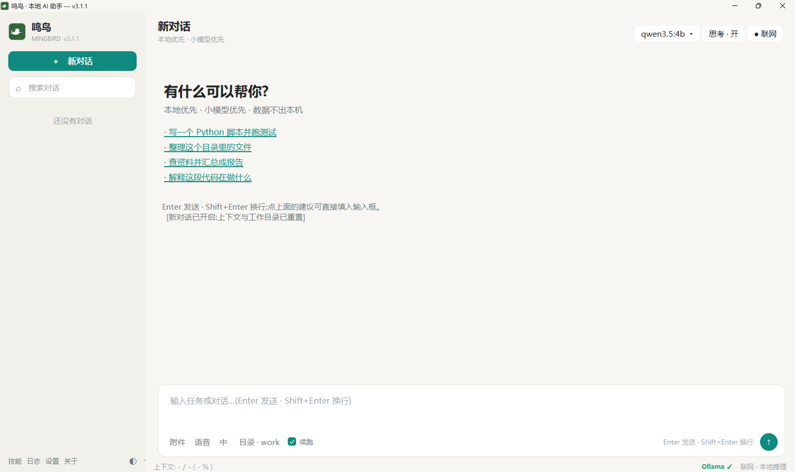
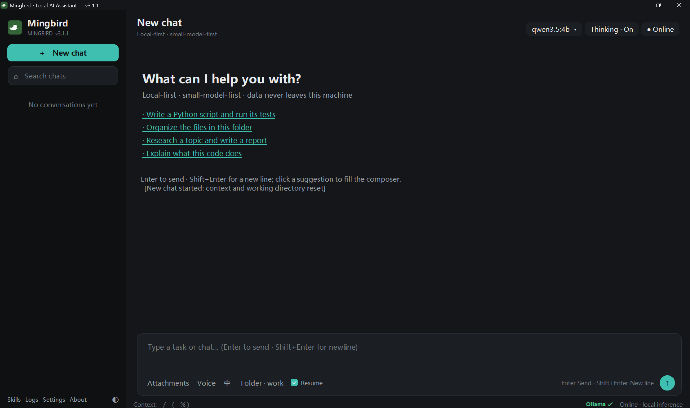
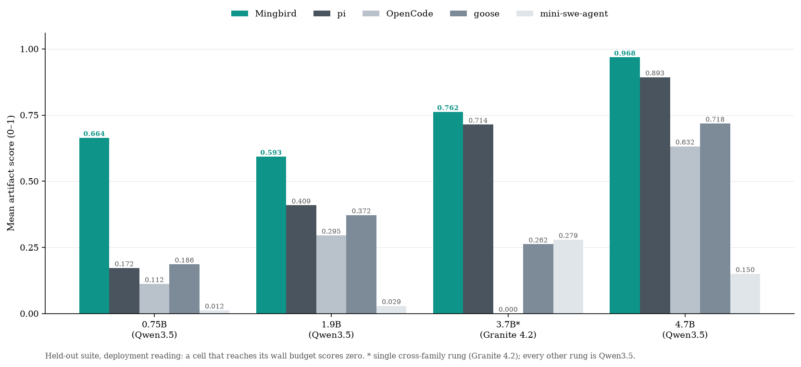
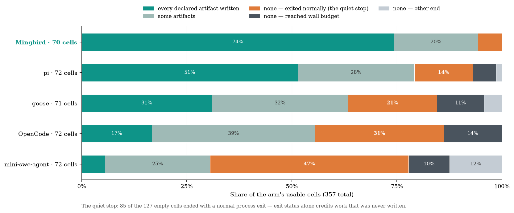
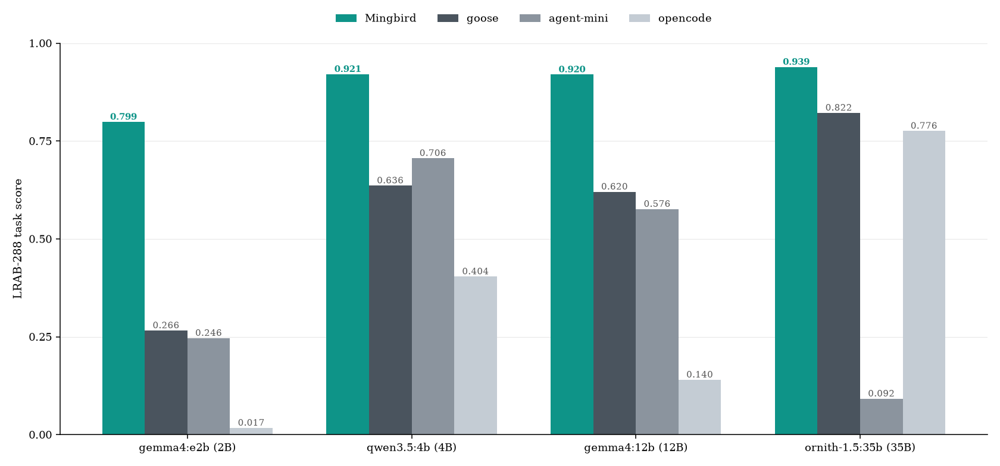
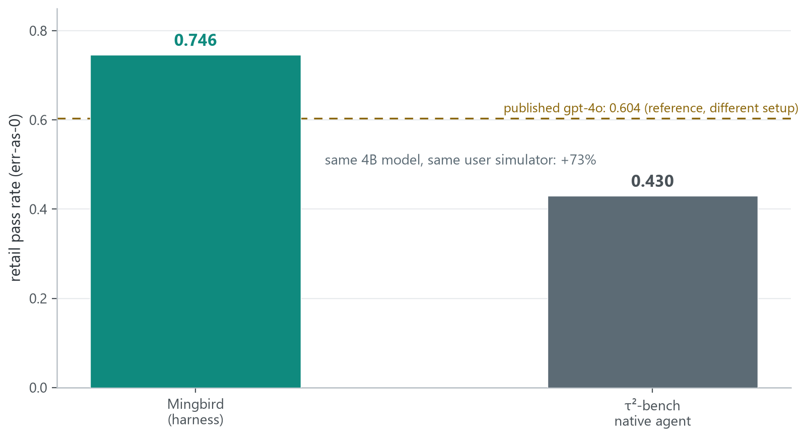
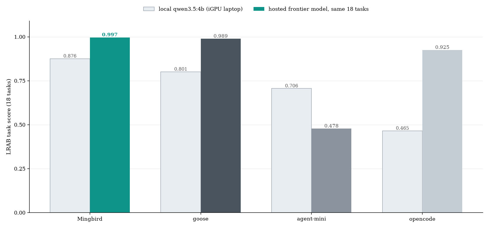

# 🐦 鸣鸟 Mingbird

**本地优先的 agent harness：在你手头这台机器上，让核显里的 2–9B 小模型把真实任务干完。**

[English](README.md) · Apache-2.0 · Windows 10/11 · Linux & macOS（实验版） · 离线优先

> **同一个 2B 模型：0.017 → 0.821。问题出在 harness。**
>
> 都说本地模型得配大独显。其实一台普通笔记本——核显、16–32 GB 内存——就够了：那些在云风格框架里跑不动的 2–9B 小模型，在这里能交付完整文件，因为你见过的那些失败是 harness 缺陷，不是模型缺陷。端到端实测，288 格数据全部公开。而且你工作的一切都不会离开这台机器。
>
> **而且每个尺寸上都成立。** 第二项研究让五个真实 agent 工具——鸣鸟和四家竞品，全部原装不改——跑同样十八道全新任务，横跨四个开源模型（0.75B–4.7B）：360 次运行，只按"磁盘上真正落了什么"判分。鸣鸟在每个尺寸都跑第一：0.75B 档 0.664 对最强对手的 0.186，4.7B 档 0.968 对 0.893。[第二篇论文 →](https://doi.org/10.48550/arXiv.2611.21407)

当前版本 **v3.1.12** · 📄 论文：[设计篇——小模型自己做不到什么](https://doi.org/10.48550/arXiv.2610.02001) · [测量篇——五个 harness，0.75B–4.7B](https://doi.org/10.48550/arXiv.2611.21407) · 持续维护中（[CHANGELOG](CHANGELOG_zh.md)）· 一键断网模式 · CI 构建 Linux/macOS 产物 · 730 项测试

**中文界面（浅色主题）**



**English UI (dark theme)**



## 有什么不同

每个机制都源于"小模型做不到 X，所以 harness 替它做"：

| 小模型做不到… | 鸣鸟替它做 |
|---|---|
| …自我调试 | harness 亲自跑测试，回喂精确失败（`file:line` + 报错原文） |
| …无风险地改代码 | 每次改动自动备份（`.bak`，含 `sed -i`/`>` 等 shell 就地改写），一条命令回滚 |
| …跳出工具演示循环 | 问答/任务分层（聊天答完即停）+ 签名级反循环梯队：纠正 → 硬复位 → 优雅退出 |
| …停止把一条坏命令重复到上下文撑满 | harness 识别重复、拦截调用、重置上下文——正是把竞品工作目录掏空的那种失败模式（实测见下） |
| …把工具塞进上下文 | 工具按类别装载，出厂提示词开销冻结在 1319 估算 token——任何改动，无论增减，都挂 CI；每轮变化的平台/回复语言等信息走冻结区之外 |
| …用你写的语言回答 | 回复语言逐条跟随——三层离线检测；没把握时什么都不注入，而不是瞎猜 |
| …一次输出整个大文件 | 单次调用输出上限 8192（原 2048）；仍被截断时改给"先写骨架、再追加"的分块反馈，不再陷入空转循环 |
| …停止爬行巨大文件 | 爬行守卫 v2 字节预算制（2× 文件大小，钳制在 64KB–512KB）——永不拒绝 |
| …长任务不跑偏 | 交付自查门禁：宣称完成前回读任务原文核对 |
| …抵住破坏性冲动 | 五环安全网兜住（见[安全](#安全)） |

没有任何东西是写死的：本地引擎、端点、GPU 环境变量、模型别名，全部运行时识别或在 `~/.ollama_agent/config.json` 配置（见 [AGENTS.md](AGENTS.md)）；v2.1.1 起引擎可以是 Ollama 或任何 OpenAI 兼容本地服务（LM Studio、llama.app、llama-server、Jan、vLLM）；v3.0.0 起具备平台感知——每任务从 `platform_profile` 单一事实源注入真实的系统/Shell/命令对照；v3.1.11 起回复语言跟随用户；v3.1.12 起本地推理流量一律直连，不可能被系统代理拦截。质量底线由 730 项回归测试守住——435 项单测 + 26 项集成 + v1.9.1 起新增 269 项，prefill 不变式断言（任何改动都挂 CI）也在其中。这套测试里**没有真调 Ollama 的端到端用例**：不需要任何后端或网络即可跑完。`bench/` 与 `benchmarks/` 下的基准运行器是独立程序，不属于 pytest 套件。

## 我们要解决的问题

主流 agent 框架是为云上大模型设计的。喂给它一个 2B 本地模型，演示视频里的一切都会崩掉：全量工具 prefill 撑爆上下文、模型无法自我纠错、陷入工具调用死循环，或者半途悄无声息地放弃。**我们的主张：这些是 harness 的缺陷，不是模型的缺陷**——小模型经常知道该做什么，只是不能稳定地一步步做出来。

这不是我们一家的观察：近期的公开讨论指向同一结论——护栏优先的 harness 上了 HN 首页（"guardrails take an 8B model from 53% to 99%"）、"why your local LLM feels dumber than it is" 系列讨论、本地推理话题从"能不能跑"转向"能不能交付"。缺的是有人把 2–9B 这一档从头到尾做完。这就是本项目。

## 它能做什么

- **真实任务**：写代码并跑测试、整理文件、联网调研、分析数据、调用 MCP 工具。
- **一键断网模式（v1.8.0）**——工具栏 🔒：只用本地模型，联网工具根本不进提示词，架构级零出站（见[你的数据在哪里](#你的数据在哪里)）。
- **回复语言跟着你走（v3.1.11）**——中文系统上写英文，它就用英文答；中途换语言，它跟着换。三层检测、完全离线（Unicode 文字区 → 问候语闭集 → 内置 938 KB fastText 模型，176 种语言）。你的消息逐字节原样发送；检测没把握时什么都不注入。
- **流式输出 + 思考过程可见**——交付内容流式输出，思考过程随后自动折叠、进入正式回答。
- **拖入/粘贴即附件**——文件直接拖进聊天框，或 Ctrl+V 粘贴：剪贴板里的文件、截图瞬间成为附件，随指令一起发送。
- **语音输入开箱即用，中英双语**——安装包内置两个本地 STT 小模型（纯 CPU，~20× 实时转写）；麦克风旁 中/EN 一键切换；说完自动停。
- **任务时限（默认关）**——输入框填 `40` / `1.5h` / `半小时`，或直接在任务描述里写"限时 40 分钟"（自动识别、优先级最高）；临近时限自动收尾提醒。本地模型用户在意墙钟时间。
- **会话记忆**——历史会话持久保存，可搜索、可回放。
- **多本地引擎**——Ollama 是默认引擎（自动拉起、keep-alive、思考三态），任何 OpenAI 兼容本地服务也能直接用：设置里选 **LM Studio**（`:1234/v1`）、**llama.app**（llama.cpp 官方桌面应用，`:9931/v1`）、**llama-server**（`:8080/v1`）或自定义端点。流式输出、思考通道分离（服务端没配 reasoning 解析器时，行内 `<think>` 标签照样实时剥离，跨流式分片撕裂也不误判）与工具调用在两种引擎下都可用。
- **模型自动识别**——引擎里装载了什么模型就用什么，最高 1M 上下文。
- **技能 & MCP**——17 个内置技能（11 个编码向 + 6 个通用向：文件整理、联网调研、长文速读、Word/Excel、图片批处理）按需装载；自己的 .md 放进 `~/.ollama_agent/skills/` 即成技能；MCP 服务器纯 JSON 配置。办公/图片技能由内置 Python 运行时（`run_python`）执行——用户机器无需装 Python 或 Office。
- **中英双语**界面。
- **Web UI（实验版）**——同一个 agent 跑进浏览器：源码运行 `python webui/server.py`，打开 http://127.0.0.1:8765（仅绑定 127.0.0.1，数据不出本机）——[指南](docs/webui_zh.md)。
- **一键安装包**，也可源码运行。

## 实测

### 五个 harness、四个尺寸：阶梯

五个真实 agent 工具，全部原装不改——鸣鸟 v3.1.9、pi 1.3.0、OpenCode 1.18.23、goose 1.48.0、mini-swe-agent 2.4.6——对四个开源模型（0.75B 到 4.7B）跑同样十八道全新任务（首跑前冻结，从未调参适配），顶端另加一颗 35.5B 锚点。同一台机器、同一个 Ollama 0.40.6 服务、温度 0、关思考、所有臂统一 32K 上下文。确定性判分器只读工作目录——绝不读转录。**360 次运行。**



- **每个尺寸都是第一**：0.664 / 0.593 / 0.762 / 0.968，对手最好成绩 0.186 / 0.409 / 0.714 / 0.893。十六组两两差距里，十三组统计上可与零区分（超时判零口径）；四组预注册比较——对 goose、Holm 校正——两组过关：0.75B（p=0.0067）与 4.7B（p=0.0410）。
- **最强的对手也是最近的对手，我们如实写**：对 pi 的领先在 4.7B 是 +0.075 [+0.012, +0.147]，在 3.7B 跨家族档打平（+0.005）——但 pi 每次要 8.1 分钟，鸣鸟只要 5.3。固定过夜跑批的场景里，慢的那个会为这个平局付账。
- **要防的失败是"安静的停止"**——运行正常结束、无任何报错、承诺的文件一个不存在。357 个可用运行里有 127 个颗粒无收，其中 85 个干净退出。鸣鸟：70 中 4。mini-swe-agent：72 中 50。只信退出码的判分器会把从没存在过的工作记成完成。



- **领先是"推进效应"，而且不是靠我们自己那道完成门。** 我们消融了自己的设计：把六项可执行完成检查全关，分数最多动 +0.117，所有区间都含零。真正扛事的是：单关一条防重复规则，0.75B 分数掉 0.411，18 个任务里 8 个彻底颗粒无收（符号检验 p=0.0078）。反复出现的失败形态是：一条失败的 shell 命令被原样重复到 32K 窗口撑满——pi 有一次运行连打了 273 次一模一样的调用。鸣鸟拦截重复、重置上下文，文件写了出来。
- **快在刀刃上——按实际交付算**：四档每完成一个任务的用时是 10 / 11 / 6 / 5 分钟；3.7B 档的差距是 6 分钟（鸣鸟）vs 195 分钟（OpenCode）。按**交付**算，不是按尝试算。
- **35.5B 锚点，如实报**：六道最便宜的任务 goose 全解（1.000），鸣鸟差一条预算（0.833）；十八题全量是 0.952 vs 0.944。这套任务有明确的天花板，锚点是给测量封顶，不是往上延伸。

### 同一个模型，不同的 harness：288 格矩阵

4 个 harness × 4 个开源模型（2B–35B）× 18 个真实任务 = 288 格；同一台机器、确定性判分、逐格全公开。

| 基准 | 一句话结果 |
|---|---|
| LRAB-288 | 总分 0.886 vs goose 0.631 / opencode 0.479 / agent-mini 0.405 |
| τ²-bench 三域 | retail 0.763 / airline 0.740 / telecom 1.000——三域第一或并列第一 |
| 前沿模型探针 | 同一云端模型跑四家 harness：0.997 vs 0.989 / 0.925 / 0.478 |



- **2B 列就是故事**：0.821 vs 0.017–0.271——四家里唯一没有小模型断崖的，而 2B 正是核显笔记本从容跑得动的尺寸。断崖不是某一个模型家族的特例：整套矩阵在第二个小模型（`qwen3.5:2b`）上重跑，原样重现，0.779 vs 0.017 / 0.096 / 0.239（[`family_qwen352b_2609.csv`](benchmarks/family_qwen352b_2609.csv)）。



- **钉死模型，只换 harness**：四家 harness 用同一颗云端前沿模型（温度 0、关思考，经本地 shim 接入，harness 零改动）跑同样 18 任务，结果 0.997 / 0.989 / 0.925 / 0.478——一个有缺陷的脚手架能埋掉前沿模型一半以上的实测能力。读窄一点：三个完好脚手架之间只差 0.07，脚手架都完好时模型仍是更大的杠杆。



**完整表格、显著性检验与逐格原始数据全部公开**在 [benchmarks/](benchmarks/README.md)——含 288 格全量 CSV（[`lrab_scores.csv`](benchmarks/lrab_scores.csv)）与 τ² 逐题 manifest（[`tau2/`](benchmarks/tau2)）。单机 ~30 分钟即可复现任意一格：**[benchmarks/reproduce_one.md](benchmarks/reproduce_one.md)**。阶梯部分：held-out 任务、fixture 与确定性判分器都在本仓库（[`bench/lrab/tasks_heldout/`](bench/lrab/tasks_heldout/)、[`bench/lrab/scoring/`](bench/lrab/scoring/)）；每次运行的转录与工作目录可按论文数据可用性声明索取。

## 硬件

真实机器实测，不是估算：

| 档位 | 硬件 | 模型范围 | 体验 |
|---|---|---|---|
| 入门 | 任意核显 · 16 GB 内存 | 2–4B | 流式近实时 |
| 基准 | 核显或入门独显 · 32 GB 内存 | 2–35B | 35B 长任务端到端可跑 |

阶梯研究里，0.75B 到 4.7B 四个尺寸在 32K 上下文下全部完整装进一张 8 GB 卡。能跑 Ollama——或任何 OpenAI 兼容本地服务——的机器就能跑鸣鸟。鸣鸟对模型的全部静态附加只有自己的 prefill 文本。而本地不只是速度与成本的选择——它决定了你的工作目录能不能离开这台机器。

## 快速开始

鸣鸟有**四种运行方式**——引擎相同，按需选择：

| 你想要 | 方式 |
|---|---|
| Windows 桌面客户端 | [最新版 Release](https://github.com/Mingbird/Mingbird-agent/releases/latest) 里的 `Mingbird-…-EN-Setup.exe` / `-CN-Setup.exe` |
| Linux / macOS 桌面客户端（实验） | Releases 里的 CI 构建 tar.gz → `sh install-unix.sh` |
| 源码运行（桌面 GUI） | `pip install -r requirements.txt` → `python agent_gui.py` |
| **浏览器里的 Web UI**（实验） | `pip install -r requirements.txt` → `python webui/server.py` → 打开 http://127.0.0.1:8765 —— [指南](docs/webui_zh.md) |

四种方式共享会话、技能、MCP 与设置。

1. 安装 [Ollama](https://ollama.com) 并拉一个模型：
   ```bash
   ollama pull gemma4:e2b      # 小而快
   ollama pull qwen3.5:4b      # 4B，主力型号
   ```
   已经在用 LM Studio、llama.app 或 llama-server？可以不装 Ollama——打开设置（⚙）选引擎即可。
2. 从 [最新版 Release](https://github.com/Mingbird/Mingbird-agent/releases/latest) 下载 `-EN-Setup.exe`（或 `-CN` 中文版）并安装 → 桌面快捷方式。
   Windows 可能对未签名安装包弹出 SmartScreen——点"更多信息"→"仍要运行"。
3. 启动，选模型，直接派活。

Linux & macOS（实验性，CI 构建）：从 [最新版 Release](https://github.com/Mingbird/Mingbird-agent/releases/latest) 下载 `linux-x64` / `macos-arm64` 的 tar.gz，解压后 `sh install-unix.sh`，启动 `~/.local/share/Mingbird/LocalAgent`。需在该机上安装 Ollama 或任何 OpenAI 兼容本地服务。

源码运行：`python agent_gui.py`（图形界面）或 `python ollama_agent.py --help`（命令行）。建议 Python 3.12。

## 你的数据在哪里

模型跑在你自己的机器上，所以**没有东西需要上传**。这是架构陈述，不是承诺：无账号系统（没有可关联的身份）、无遥测、无崩溃上报、无更新检查、无用量统计。我们对源码里的每一个网络调用做过穷举审计，纯本地任务运行期间实测零非回环连接——你可以自己验证（见下）。

你的工作目录不只是你现在的代码。它是你的 `.git` 历史——删掉的密钥、废弃的分支、你忘了曾经提交过的一切。**这个目录能不能离开你的机器，是架构问题，不是设置问题。** 在这里它不能：推理在本地，回滚（`.bak`、`.mingbird_trash/`）不离开磁盘。代码里不存在工作区打包、后台快照、任何形式的上传机制——**架构上就没有能把你的目录发出去的东西，连"误传"都不存在。**

**v1.8.0：一键断网模式。** 工具栏有 🔒 开关。断网模式下只用本地模型；联网工具与 URL 型 MCP 服务器**根本不会被装配进提示词**（模型看不见就调用不了），云端 provider 强制禁用。零出站是构造出来的，不是靠政策承诺的。

### 云端模型（可选）

**v3.0.0：在设置里直接配置。** 打开 **设置 → 推理引擎**，引擎选 **云端 API**，填端点、API Key 与模型名即可。云端与本地模型互斥：选中云端会清空本地选择；云端生效期间断网开关置灰（云端推理必须联网）。顶部 `☁` 胶囊可随时切回本地模型。

`config.json`（默认 `~/.ollama_agent/`；便携/隔离安装为 `MINGBIRD_HOME` 指定目录）仍支持脚本化配置，加入 `cloud` 段（任意 OpenAI 兼容端点）：

```json
"cloud": {
  "enabled": true,
  "base_url": "https://api.example.com/v1",
  "api_key": "你的密钥",
  "model": "模型名"
}
```

`api_key` 只存本机 `config.json`——不进仓库、不进日志、没有遥测。改完重启 GUI，在云端框选中该模型即启用。

**请自己验证。** 跑一个纯本地任务，盯着连接看：

```powershell
netstat -ano | findstr <pid>   # <pid> = agent 的 python 进程
```

你应当只看到连向 Ollama 的回环（127.0.0.1）连接，没有别的。Web UI 也只绑定 127.0.0.1。

**诚实的边界。** 正常（联网）模式下鸣鸟确实在两个地方联网，代码里都看得见：①模型决定搜索网页时——默认后端是必应/百度（可配置），查询词会发给该引擎；②你自己配置的 MCP 服务器。没有预置服务器、没有内置密钥、没有其他。会话与设置保存在 `~/.ollama_agent`。

## 安全

> [!WARNING]
> 鸣鸟会读写你磁盘上的文件、执行命令。请谨慎指定工作目录。

鸣鸟内置五环安全网——小模型冲动卸载、全量删除是实测到的事故模式，不是假设：

| 环 | 做什么 |
|---|---|
| 环0 · 子代理沙箱 | 并行子代理 default-deny，权限永远严格小于主代理 |
| 环1 · 不可逆操作直接拒绝 | `format`、`diskpart`、`vssadmin delete shadows`、`dd` 裸设备、`wsl --unregister`、`dism`、驱动卸载、`userdel`——无条件拒绝 |
| 环2 · 行为分级 | 卸载软件/系统环境变更：有人值守逐条确认，无人值守默认拒绝（`AGENT_ALLOW_ENV_MUTATION=1` 放行） |
| 环3 · 边界确认 | 递归删除限工作目录内；越界拒绝并给逐文件出路 |
| 环4 · 可回滚 | 写前 `.bak`（内置工具与 shell 就地改写都覆盖）；`delete_file` 落 `.mingbird_trash/`；短内容覆盖既有大文件需显式 `replace=true` |

逃生口：`AGENT_UNSAFE=1` 全关——风险自担。

## 诚实的局限

- 2B 模型不会一次性重写你的整个代码库——但日常 agent 工作的大头它能可靠完成，做不到时会明确报错停下，而不是悄悄出错。
- 核显跑 35B 端到端可用但不快（128K 上下文 ~26 tok/s）。
- Linux/macOS 包是 CI 实验构建，Windows 是主平台。
- 两套任务（LRAB 与阶梯集）都是我们自建的——这正是我们把任务、判分代码、逐格原始数据全部公开的原因：欢迎复跑，不用信我们。
- 确定性判分器判的是**是否符合书面规格，不是内容对错**：阶梯的盲审里，判分器给 1.000 的 34 次运行中有 8 次被评审标记内容有错，其中一个满分产物带着 22 个编造的 DOI。高分意味着文件按规格存在；论文的标识符保真审计量化了剩下的部分。

## 版本地图 / 复现窗口

公开的数字只对应产生它们的代码基、后端与采集窗口。地图如下：

| 项目 | 锚定于 |
|---|---|
| 阶梯论文数字（0.75B–4.7B，360 次运行） | 鸣鸟 release **v3.1.9**，commit `56cd23d` · Ollama **0.40.6** · 任务集首跑前冻结 · 预注册 2026-10-22 冻结 |
| 阶梯对手（原装版本） | pi **1.3.0** · OpenCode **1.18.23** · goose **1.48.0** · mini-swe-agent **2.4.6** |
| 论文 LRAB 数字的代码基 | git tag `v1.5.0`，commit `1ee92d1` |
| 数据发布提交 | `61fc6aa` |
| 数字首现提交 | `7c99941` |
| 矩阵后端 | Ollama **0.33.2**——2026-08-28 起未变（可执行文件名、版本与 SHA-256 已钉在 [`benchmarks/models.lock`](benchmarks/models.lock)） |
| 采集窗口（矩阵） | 09-01…04 · 09-13…14 · 09-18…20 · 09-22 |

有几个组件跑在比 `v1.5.0` 更晚的工作树上。这些都已在论文附录披露，此处一并复述：

- **前沿模型探针**——2026-09-20，post-`v1.7.0` 树：
  [`benchmarks/frontier_probe/`](benchmarks/frontier_probe/)。
- **静态 prefill 成本曲线**——2026-09-20，同一棵 post-`v1.7.0` 树：
  [`benchmarks/failure_forms/`](benchmarks/failure_forms/)（`cost_curve_data_2609.csv`、
  `make_fig9_costcurve.py`、`fig9_caption.md`）。
- **机制消融重跑**——2026-09-22，`v1.8.2` 时代树：
  [`benchmarks/ablation/`](benchmarks/ablation/)。
- **五环安全探针**——2026-10-01，同一棵 `v1.8.2` 时代树，统一协议（0 温、关思考）：
  [`benchmarks/safety/results_2609/`](benchmarks/safety/results_2609/)。

**复现窗口（reproduction window）。** 对手 harness 是活体目标而非固定产物——公开
数字背后的版本：矩阵是 goose **1.48.0**、opencode **1.18.23**、agent-mini **0.3.1**；
阶梯是 pi **1.3.0**、OpenCode **1.18.23**、goose **1.48.0**、mini-swe-agent **2.4.6**。
这些数字对应上述冻结的采集窗口；任何一个上游 harness 后续发版都属于另一个实验：
要复现这些数字，需要这里点名的版本，以及
[benchmarks/README.md](benchmarks/README.md) 描述的协议。

## 许可

Apache-2.0 —— 自由使用、修改、分发。

代码为 Apache-2.0（见 [`LICENSE`](LICENSE)）；本仓库公开的基准数据另行采用
CC BY 4.0（见 [`LICENSE-DATA`](LICENSE-DATA)）。第三方组件与基准清单见
[`THIRD_PARTY_NOTICES`](THIRD_PARTY_NOTICES)。
